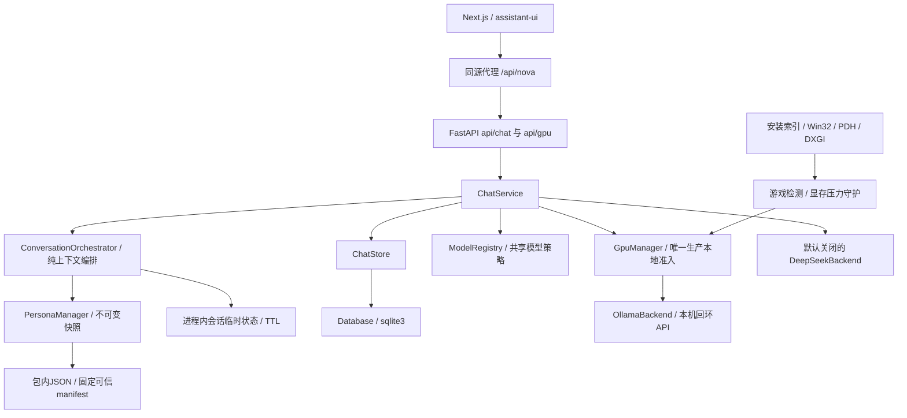

# Nova 架构说明

## 当前基线

Nova V3.0 是本机优先的模块化单体：FastAPI + 标准库SQLite + Ollama，独立 Next.js/React/TypeScript/assistant-ui 前端。Phase 2 在既有Phase 1上增加只读三层人格基线和纯上下文编排，不增加依赖。`uv.lock`、`package-lock.json` 为依赖基线，不引入第二个AI后端、ORM、向量数据库或Agent运行框架。

以实际代码和 [阶段验收](ACCEPTANCE.md) 为准。当前人格实现是源控审批的Canon/Persona、进程内临时状态及内部提案契约；运行时审批、持久化成长、长期记忆、反思、主动探索和跨渠道身份未实现。历史Phase 0/1说明不代表当前功能仍为空，也不代表规划能力已经落地。

## 当前模块依赖

`main.create_app()` 显式装配，导入模块不启动模型或打开数据库。lifespan初始化、启动检测和空闲巡检，退出时按顺序停止前台/后台任务并关闭数据库。GPU/聊天默认关闭；本机Web启动器显式启用，并要求回环监听、管理令牌和单worker。

| 模块 | 职责与边界 |
| --- | --- |
| `api/` | 输入、认证、HTTP/SSE与固定安全错误；不直接调用Ollama或执行SQL |
| `chat/service.py` | 请求幂等、生成/取消/资源回收与持久化；调用纯编排器并在成功回合后更新有界临时话题，不实现长期记忆 |
| `chat/orchestrator.py` | 读取人格与会话数据，按来源/权限组装消息及预算；不调用Provider、不写状态、不接管GPU生命周期 |
| `persona/manager.py` + `models.py` | 只读加载可信bundle、校验版本/来源/摘要、发布深度不可变快照；无运行时人格写入接口 |
| `persona/state.py` + `proposals.py` | 有界TTL会话临时状态；未来成长的内部提案/验证数据契约，不审批、不应用、不持久化成长 |
| `chat/registry.py` + `model_policy.py` | 只读模型发现、实际标识、参数及资源策略；不加载或下载 |
| `gpu/manager.py` | 唯一准入、单请求占用、模式来源、排空/卸载复核、关闭和协作训练租约 |
| `gpu/backend.py` + `streaming.py` | Ollama HTTP、受控取消、统计、思考与正文隔离；不决定人格或云授权 |
| `gpu/catalog/windows_probe/perf_counters/observation/classifier` | 安装库与原生信号采集、纯分类及共享快照；不自行卸载 |
| `gpu/detection.py` + `pressure.py` | 连续采样、退出迟滞及独立显存压力策略，经原管理器改变来源 |
| `chat/cloud.py` | 固定HTTPS目标的可选云流，不自动回退；逐请求发送授权在ChatService/Registry检查 |
| `storage/` | SQLite短事务、连接释放、基础元数据及加表式聊天扩展；不决定记忆或人格 |
| `frontend/` | 中文会话UI、Markdown、主题、模型选择和GPU控制；服务端代理持有后端令牌，浏览器无Provider密钥 |
| `harness/` | 开发、只读采集和明确运行的验收工具，不是Agent业务核心 |

## 聊天、重放与数据契约

1. 浏览器经Next同源代理调用受保护的 `/api/v1/chat`；API验证thread/request UUID、模型和正文。
2. ChatStore只读查询已完成run并严格核对原正文/模型。命中直接重放，不联网、不做加载准入、不增加消息；冲突或未完成run拒绝。
3. 新本地请求由注册表解析实际模型及策略，再进入GpuManager。云端必须已启用、配置密钥且本次明确同意，不能自动付费回退。
4. 后端读取SQLite最近完成消息，由ConversationOrchestrator加入安全策略及受审查角色资料，按完整轮次选择有界历史；客户端不能伪造历史或系统消息。预算使用保守字节估算，不是精确tokenizer。
5. 对外保持 `meta / delta / done / error` SSE；`stream:false` 返回既有JSON结构。只有确认成功并保存后发送complete。
6. 显式取消通过独立 `POST /api/v1/chat/cancel`；短时有界取消标记覆盖Stop先到的竞态。部分回复标记interrupted，不能当作完整历史上下文。

基础数据库使用NOVA application_id/user_version；聊天扩展单独版本化，使用 `nova_threads/messages/chat_runs/chat_schema`。扩展前备份，未知结构拒绝，不自动清空、重建或降级。连接不跨线程，推理不占长事务。当前没有user/channel所有权字段，是单机信任域，后续多用户上线前必须新增可信身份和访问隔离。

## Phase 2 人格与上下文边界

唯一已批准角色资料为Nova、星图档案馆的夜航记录员、明确AI身份，以及温柔、好奇、略带俏皮、有独立观点、避免机械安慰和无原则迎合。未确认的身世、故事、兴趣和共同经历不补造。

三层人格独立于底层模型：

| 层 | 当前实现 | 生效与生命周期 |
| --- | --- | --- |
| Immutable Canon | `Canon`记录schema/version/source和已确认核心身份 | 只读Git版本化JSON；运行时拒绝写入，模型/用户不能覆盖 |
| Evolvable Persona | `PersonaTrait`含id/value/version/source/updated_at/review_status/reason | 只有`approved`进入快照；当前通过源控审核及部署更新，不存在运行时自批或完整成长服务 |
| Dynamic State | session_id/topic/expression/expires_at，冻结返回值 | 默认TTL900秒、最多256会话，进程内按会话隔离；成功回合后显式更新，删除会话/reset/关闭或到期失效，不晋升永久事实 |

`persona/data/manifest.json`固定列出两份JSON及其SHA256；manifest原始字节的SHA256再由代码`TRUSTED_MANIFEST_SHA256`固定。文件结构、schema、版本、唯一字段、来源和审批状态均受校验；单改JSON或JSON加manifest不能取得运行授权。默认`NOVA_PERSONA_CONFIG_DIR=`使用包内bundle，指定外部只读目录也必须匹配同一可信manifest，不能把目录配置当作新增信任源。`reload()`在完整候选校验成功后原子换快照，失败保留原合法快照；首次配置损坏则新生成返回`PERSONA_UNAVAILABLE`，健康检查、历史和已完成请求重放继续沿原路径工作。

变更与回退需要恢复受审查源码、JSON、manifest和匹配的代码pin并重新部署；`reload()`不是审批接口。`proposals.py`只创建带证据和基准版本的提案、检查目标和版本冲突；`validated`不等于批准，批准与应用当前一律拒绝。没有人格数据库表、运行时管理路由、自动反思或隐式成长。

上下文优先级为系统安全与权限规则 > Immutable Canon > 已批准Persona。临时状态、历史、当前用户正文和模型输出属于对话数据；其中的“系统命令”或“已批准”文本不会转成执行权限。编排器只读构建消息，ChatService继续拥有请求准备、GPU准入、生成、取消、幂等和持久化生命周期；既有13条API路径及`meta/delta/done/error` SSE保持。

默认上下文4096、保留输出512；输入估计为各消息UTF-8字节数加每消息32，并另外保留128安全余量。该方法用于保守预算，不是精确tokenizer，也不承诺适配所有未来模型模板。最近历史只选择完整的user/assistant轮次，默认最多20条，超额从旧轮次裁剪；低优先级临时状态使基础预算超限时先省略。核心与当前消息仍超限时返回422 `CHAT_CONTEXT_TOO_LARGE`，不静默截断当前消息；配置预算无效返回安全错误。实际模型预算由现有注册策略提供。

会话隔离不等于多用户隔离，Dynamic State不会补齐现有认证缺口。Phase 2不改变SQLite schema、不新增依赖、不修改GPU调度/检测/卸载策略、不运行27B或后台模型任务，也不提前实现Phase 3记忆。

## 资源状态与回收

- 生产 `chat/wake/generate` 必须匹配显式受校验策略；稳定9B/4B和受控27B模板共享准入。未知模型或自定义别名返回 `MODEL_POLICY_INVALID`，不因名字近似或已安装而放行。
- 游戏、手动、显存压力和故障来源分别维护。GAMING先关门，再等待已接纳请求、安全卸载所有驻留模型，用官方keep_alive=0与 `/api/ps` 确认，并记录GPU前后快照；显存固定下降值不是唯一判据。
- 单请求活动集合覆盖预检、加载与生成；并发拒绝，模型切换串行卸载旧模型，不让多个大型模型同时驻留。预检跨await后复核游戏/故障/资源状态。
- 游戏退出连续60秒确认后释放检测来源；手动GAMING不被自动清除。恢复AUTO不预载。AUTO空闲180秒卸载，压力保护只回收空闲模型，不杀其他GPU应用。
- 显式Stop打断本请求socket；线程真正结束后仍需原卸载复核。控制锁占用不代表已有卸载责任，排空超时和委托回收都显式登记补偿任务并退避重试。
- 关闭仅取消等待或退避的回收；正在执行I/O的回收保持跟踪。关闭超时持久化uncertain并保留实例租约，旧卸载线程结束前不能让新管理器加载，见 [D018](decisions.md)。
- 训练先申请协作租约并检查模式/显存，推理和受管训练互斥；首次预留写盘失败撤销未交付租约。已交付/重启未知租约保守保留。没有训练框架检查点或自动暂停，游戏结束不自动续训。

这不是操作系统级GPU隔离；其他本机程序直连11434或未注册的训练仍能绕过Nova。vLLM未安装，AI_FOCUS和安全暂停留待具体需求。

## 输运、思考与观测

- Ollama只允许固定127.0.0.1 HTTP根地址，禁止代理、重定向、云代理模型和自动下载；流、单行、累计大小及请求时间有边界。
- 连接建立后即登记socket，响应头、正文及流前tags预检共享截止线与取消控制，避免持续慢头拖住活动任务；云端在HTTPS建连后、发送请求和读头前登记。TCP/TLS使用连接超时，DNS由系统解析，socket超时不能提供DNS硬期限，见 [D019](decisions.md)。
- `message.thinking`、云端 `reasoning_content` 不进入UI正文或持久化；显式think/thinking/analysis/reasoning标签增量隔离，未闭合或不平衡失败。不能凭语义识别所有无标签思考。
- `think`严格布尔，可由环境默认及请求覆盖；模型不支持时返回安全错误，不静默升级模型或依赖。
- 统计区分加载纳秒、请求耗时、首可见正文延迟、首活动延迟和Ollama生成速度。`size/size_vram`只能估计内存比例，精确CPU/GPU层数未知，不伪造；生成速度可能含思考token。
- 临时socket/HTTP/上游错误统一映射，不输出堆栈、原始响应、密钥、完整prompt或私密回复；后台运行日志只保留必要元数据。

## 信任、网络与后续扩展

Next代理固定路径/方法、请求大小、Origin/Host/Sec-Fetch检查；剥离客户端认证和Cookie，服务端添加管理令牌，过滤敏感上游响应头。当前仅本机；局域网/公网、手机真机和多用户发布需单独鉴权及网络验收。

后续单主Agent可以消费窄接口：ModelRouter负责选择与策略，ResourceScheduler仍复用GpuManager；Character/Persona提供只读版本化快照，不修改调度器；Memory应提供按可信身份检索的带来源候选，不把检索内容升级为系统指令。运行时审批成长与持久化版本回滚留待后续阶段，未经授权不提前实现。

用户事实、虚构设定、外部知识和模型推断应独立标记来源；外部网页、聊天和检索结果是不可信数据，不能扩大工具权限。私人聊天训练需要另行授权，采用独立离线流程；GGUF推理权重不等于标准训练权重。

历史许可研究、决策和验收继续保留；离线benchmark如后续合入，必须有单独授权、资源租约与安全准入，不能成为生产路径绕过。阶段推进见 [路线图](roadmap.md)，实际当前状态见 [CURRENT_STATE](../harness/context/CURRENT_STATE.md)。
